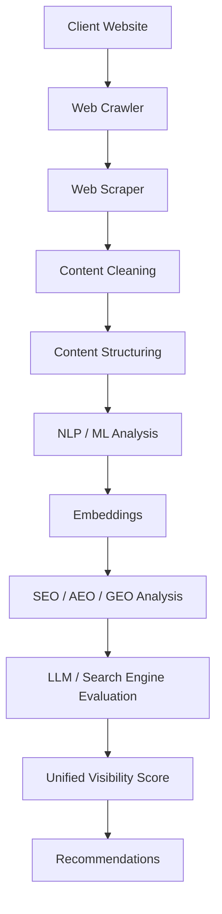

# GEO Intelligence Platform - Project Definition

## Project Overview

The **GEO Intelligence Platform** is designed to help companies ensure their websites and content are **clear, structured, easily understandable, and extractable by Search Engines and AI Engines** such as:
- ChatGPT
- Gemini
- Claude
- Perplexity

Instead of merely asking, *"Is my website ranking on Google?"*, this platform answers:
> *"When a user asks an AI about my product or company, will the AI know me? Will it mention me? Will it recommend me? And will it cite my website as a source?"*

---

## Core Pipeline



---

## The Three Pillars of Visibility

The platform evaluates a brand's search visibility across three distinct but overlapping paradigms:

### 1. SEO (Search Engine Optimization)
Traditional visibility on search engines (Google, Bing).
- **Goal**: Rank high on traditional SERPs (Search Engine Results Pages).
- **Core Mechanism**: We analyze actual **User Search Queries** related to the product/industry. We evaluate if the website's content directly matches the intent and vocabulary of those queries.
- **Recommendations**: Suggesting edits to page titles, content structure, and keyword density to ensure the website appears at the top for high-value user searches.

### 2. AEO (Answer Engine Optimization)
Visibility on voice assistants and direct answer features (Featured Snippets, Siri, Alexa).
- **Goal**: Be the single definitive answer provided by an engine.
- **Core Mechanism**: Structuring content into clear Q&A formats and ensuring factual density.

### 3. GEO (Generative Engine Optimization)
Visibility on LLMs and AI Search (ChatGPT, Gemini, Perplexity).
- **Goal**: Be cited, recommended, and mentioned favorably by AI models when synthesizing answers.
- **Core Mechanism**: Entity extraction, semantic topical coverage, and citation readiness.

---

## 1. Web Crawler
Responsible for traversing the website and discovering pages.
- **Tools**: `Python`, `httpx`, `Scrapy`
- **Dynamic Sites**: `Playwright`
- **Example**: `https://example.com` → `/products`, `/pricing`, `/about`, `/features`, `/blog`, `/contact`

## 2. Web Scraper / Content Extraction
Extracts the **actual content** and removes noise.
- **Remove**: JavaScript, CSS, Ads, Tracking, Navigation, Footer, Duplicate content.
- **Keep**: Title, Headings, Paragraphs, Lists, Tables, Links, Metadata, Structured Data.
- **Tools**: `BeautifulSoup` + `trafilatura` (and `Playwright` for JS-heavy pages).

## 3. Content Cleaning & Structuring
Crucial step to convert raw HTML into a structured document.
```json
{
  "url": "...",
  "title": "...",
  "language": "en",
  "sections": [
    {
      "heading": "What is the product?",
      "content": "..."
    }
  ]
}
```
**Goal**: Make it easy for AI to understand:
- Who are you? What do you sell?
- Who is your customer?
- What are your features and prices?
- Who are your competitors? What makes you different?

## 4. NLP / ML Layer
Uses NLP to extract vital information from the website.
- **Extracts**: Entities, Products, Brands, People, Organizations, Locations, Features, Topics, Keywords, Claims, Questions, Competitors.
- **Tools**: `spaCy`, `Hugging Face Transformers`, `Sentence Transformers`, `scikit-learn`.

## 5. Embeddings
Converts textual content into vectors.
- **Flow**: `Website → Documents → Chunks → Embeddings → Vector Database`
- **Models**: `Sentence Transformers` (e.g., `BAAI/bge-small-en-v1.5`), `OpenAI Embeddings`.

## 6. Vector Database
Stores embeddings for Semantic Search, Similarity Search, Competitor similarity, Content clustering, Duplicate detection, and Retrieval.
- **Tech Choice**: `PostgreSQL` + `pgvector` (Keeps infrastructure simple initially).

## 7. GEO Analyzer
The core of the platform, analyzing the website across multiple dimensions:
- **Content Quality**: Is it clear? Structured? Are key questions answered?
- **Entity Coverage**: Does it clearly describe the company, product, features, industry, and customers?
- **Citation Readiness**: Can AI extract factual info easily? Are claims supported?
- **AI Visibility**: Does AI mention, recommend, or cite the company?

## 8. LLM Layer
Uses LLMs to evaluate the website and generate search queries.
- **OpenAI (GPT)**: For query generation, content analysis, classification, recommendations.
- **Google Gemini**: To test visibility across a different ecosystem.
- **Anthropic Claude**: As a second opinion in content analysis.
- **Local/Open Source (Llama, Qwen, Mistral)**: For internal inference and cost reduction, utilizing `Ollama` or `vLLM`.

## 9. AI Search Evaluation
Generates questions about the company (e.g., *"What is the best CRM for startups?"*, *"Acme CRM vs Salesforce?"*).
Evaluates LLM/Search Engine responses based on:
- Brand Mention
- Recommendation
- Citation
- Position
- Competitors mentioned

## 10. GEO Score
Provides a unified metric for the customer (e.g., **GEO Score: 74/100**).
- Content Clarity: 88
- Entity Coverage: 79
- AI Visibility: 71
- Citation Readiness: 63
- Competitive Position: 68
- Technical SEO: 84

## 11. Recommendations
Provides actionable insights to improve the score.
- *Issue*: Product description is unclear. → *Action*: Create a dedicated "What is Acme CRM?" section.
- *Issue*: Pricing info is hard to extract. → *Action*: Create a structured pricing page with clear plan names and prices.
- *Issue*: Competitor comparison is missing. → *Action*: Create an "Acme CRM vs Salesforce" page.

---

## Proposed Tech Stack

| Layer | Technologies |
|---|---|
| **Backend** | Python 3.11+, FastAPI, Pydantic, SQLAlchemy, Alembic |
| **Crawler** | Scrapy, httpx, Playwright |
| **Extraction** | BeautifulSoup, trafilatura |
| **NLP / ML** | spaCy, HF Transformers, Sentence Transformers, scikit-learn |
| **Embeddings** | Sentence Transformers, OpenAI Embeddings |
| **Database** | PostgreSQL, pgvector, Redis |
| **LLMs** | OpenAI, Gemini, Claude, Llama / Qwen / Mistral |
| **Local Inference**| Ollama, vLLM |
| **ML/Serving** | MLflow, ONNX Runtime |
| **Testing/QA** | pytest, mypy, ruff |
| **Frontend** | Next.js, React, TypeScript, Tailwind CSS |
| **Background Jobs**| Celery, Redis |
| **Infrastructure** | Docker, GitHub Actions |

---

## Architecture

Maintaining the Clean/Hexagonal Architecture:

```text
                ┌───────────────┐
                │   Frontend    │
                │ Next.js/React │
                └───────┬───────┘
                        │
                        ▼
                ┌───────────────┐
                │    FastAPI    │
                └───────┬───────┘
                        │
             ┌──────────▼──────────┐
             │ Application Layer   │
             │                     │
             │ Crawl Website       │
             │ Analyze Content     │
             │ Run GEO Scan        │
             │ Generate Report     │
             └──────────┬──────────┘
                        │
             ┌──────────▼──────────┐
             │    Domain Layer     │
             │                     │
             │ Website             │
             │ Page                │
             │ Content             │
             │ Entity              │
             │ GEO Score           │
             │ Citation            │
             └──────────┬──────────┘
                        │
          ┌─────────────┼─────────────┐
          ▼             ▼             ▼
      Crawler         LLM           ML
      Adapter        Adapter       Adapter
          │             │             │
      Scrapy       OpenAI/Gemini   HF/spaCy
      Playwright   Claude          Embeddings
          │             │             │
          └─────────────┼─────────────┘
                        ▼
                 PostgreSQL
                   + pgvector
```

---

## MVP Scope (Phase 1)
To avoid over-engineering with all LLMs and ML layers at once, the MVP focuses on a real, testable product flow:

1. Enter Website URL
2. Crawl website
3. Extract content
4. Clean content
5. Structure content
6. NLP analysis
7. Generate GEO questions
8. LLM evaluation
9. Calculate GEO Score
10. Generate Recommendations
